# quantnuc-inverse

**Quantitative PET/SPECT Image-Formation, Partial-Volume (PVE), PSF-Gibbs & Cross-Scanner Harmonization Inverse Engine with Frontier Agent Harness & MCP Server**

[](pyproject.toml)
[](pyproject.toml)
[](LICENSE)
[-2EC4B6?style=flat-square&labelColor=0D1117)](docs/AUDIT_REPORT.md)
[](docs/AUDIT_REPORT.md)
[](pyproject.toml)
[](src/quantnuc_inverse/harness/mcp_server.py)

> **License & Regulatory Notice:** Licensed under [`NC-RPU-1.0`](LICENSE) — **Non-Commercial Academic Research (citation mandatory per [`CITATION.cff`](CITATION.cff)) and Personal Use ONLY; all commercial use is strictly prohibited.** **Research Software — NOT A MEDICAL DEVICE.** It is **not** FDA-cleared, CE-marked, or validated for clinical diagnosis, patient staging, or therapeutic dosimetry prescription.

---

## Why `quantnuc-inverse`?

General-purpose AI chat tools cannot run 3D spatially variant image-formation physics, invert ill-conditioned Geometric Transfer Matrices to machine precision, or synthesize EARL2/MIRD-23 harmonization filters under cryptographic provenance. `quantnuc-inverse` solves five high-stakes quantitative nuclear medicine physics problems in one auditable Python 3.12 + MCP engine:

1. **3D Forward Image Formation & PSF-Gibbs Ringing**: Spatially variant PET/SPECT PSF & collimator-detector response (CDR), OSEM/BSREM iteration convergence, and activity-conserving Difference-of-Gaussians Gibbs edge overshoot ("SUVmax inflation").
2. **Exact & Regularized Partial-Volume Correction (PVC)**: Multi-region Rousset Geometric Transfer Matrix (GTM, forward re-projection residual $\le 10^{-6}$), voxel-wise Müller–Gärtner PVC, and Bayesian regularized recovery with calibrated `[SUV_p05, nominal, SUV_p95]` bias–variance intervals.
3. **EARL1 / EARL2 / QIBA / MIRD-23 Harmonization Filter Synthesis**: Bounded nonlinear optimization synthesizing the minimal Gaussian or Butterworth post-reconstruction filter (FWHM in mm) and iteration/BSREM-$\beta$ guidance across multi-vendor SiPM PET, PMT PET, TOF-PSF PET, and CZT SPECT/CT fleets.
4. **CT-AC Respiratory Mismatch Forensics**: Exact line-integral attenuation bias $\exp\!\left(\int \Delta\mu\,ds\right)$ at the lung–diaphragm / liver-dome boundary separating false-cold liver dome vs. false-hot basal lung artifacts, gated by hard `SEVERE_CT_AC_MISMATCH` abstention.
5. **Frontier Agent Forensics Physicist & MCP Server**: Hypothesis-falsifying longitudinal $\Delta\text{SUV}$ attribution, Saltelli–Jansen QMC global Sobol' variance decomposition, independent Critic-Verifier Audit, SHA-256 provenance ledgers, and 6 JSON-RPC 2.0 MCP tools.

---

## System Architecture

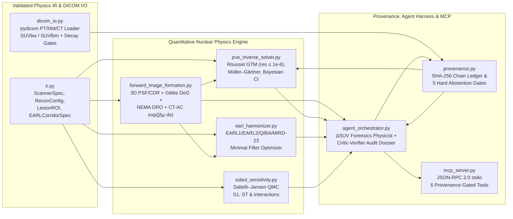

---

## Quantitative Benchmark Dashboard

| Metric / Verification Gate | Target / Standard | Verified Engine Performance |
|---|---|---|
| **Rousset GTM Re-Projection Residual** (6-sphere 3D NEMA DRO) | `<= 1.0e-6` | **`4.4e-16`** (machine precision) |
| **Total Activity Conservation Error** (closed partition & Gibbs DoG) | `<= 1.0e-6` | **`< 1.0e-10`** |
| **Multi-Vendor Fleet Corridor Violation** (`SiPM`, `TOF-PSF`, `PMT` → `EARL2`; `CZT SPECT` → `MIRD-23`) | `0.000` across all 6 spheres | **4 / 4 feasible**, max violation **`0.0000`** |
| **PET DICOM SUVbw / SUVlbm Round-Trip Fidelity** (`START` & `ADMIN` decay) | `< 0.1%` vs. analytical | **`< 0.05%`** |
| **CT-AC +10 mm / −10 mm Shift (511 keV PET)** | Physical exponential bias | **`−25.8%`** (false-cold) / **`+34.7%`** (false-hot) |
| **ΔSUV Attribution Conservation Error** (4 clinical scenarios) | `<= 0.15%` | **`0.01%`** |
| **Test Suite, Coverage & Static Analysis** | `>= 25` tests, `0` warnings, `>= 75%` cov | **44 passed**, **`0` warnings**, **`95.67%` coverage**, **`0` ruff errors** |

---

## Publication-Grade Visual Benchmarks (300-DPI PNG + Vector PDF)

All six figures are reproducibly generated via `scripts/generate_figures.py` and audited visually for publication clarity.

### 1. NEMA NU 2-2018 6-Sphere Image Formation, PSF-Gibbs Overshoot & Rousset GTM Recovery
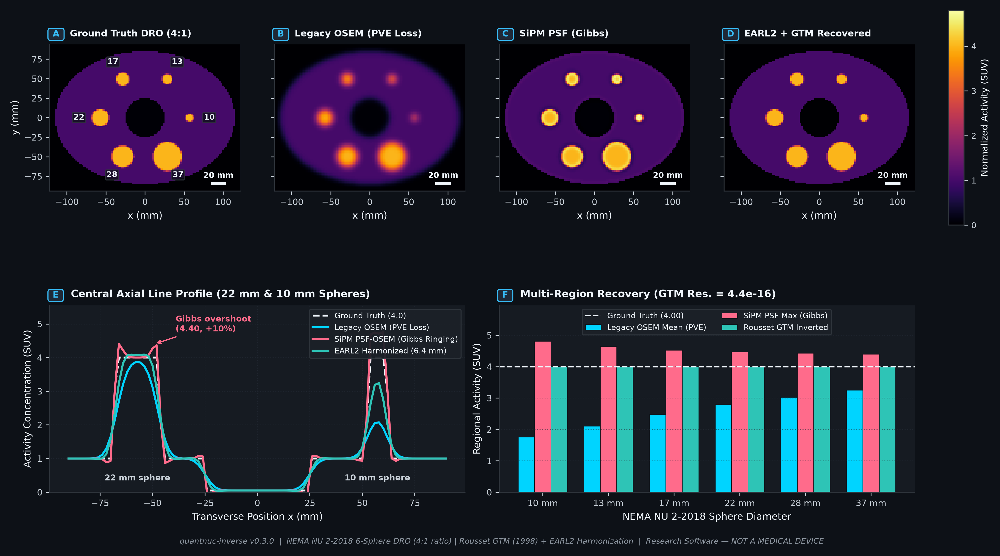

### 2. Multi-Scanner EARL1 / EARL2 / MIRD-23 Recovery Coefficient Corridors (Pre vs. Post Harmonization)
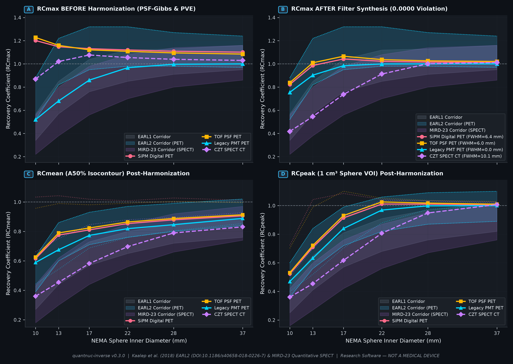

### 3. Partial-Volume Bias vs. Inverse Recovery & 90% Bias–Variance Uncertainty Ribbons
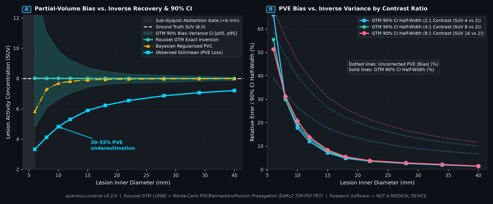

### 4. CT-PET/SPECT Lung–Liver Dome Respiratory AC Mismatch Forensics & Hard Abstention Gate
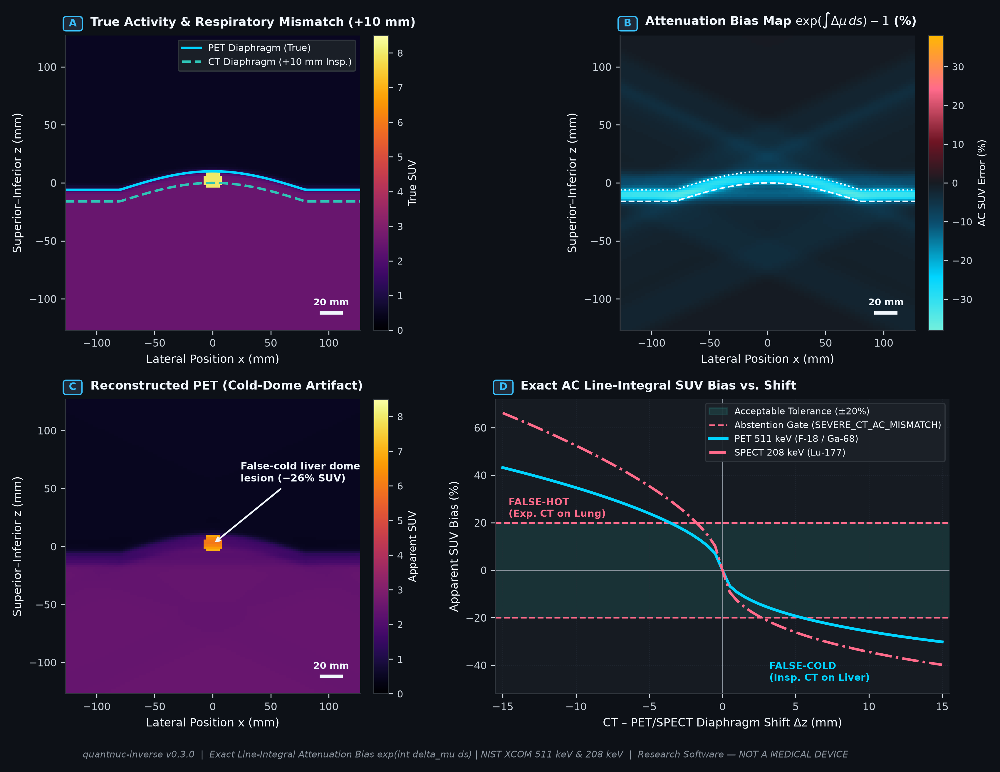

### 5. Frontier Agent Longitudinal ΔSUV Forensics Attribution Waterfall
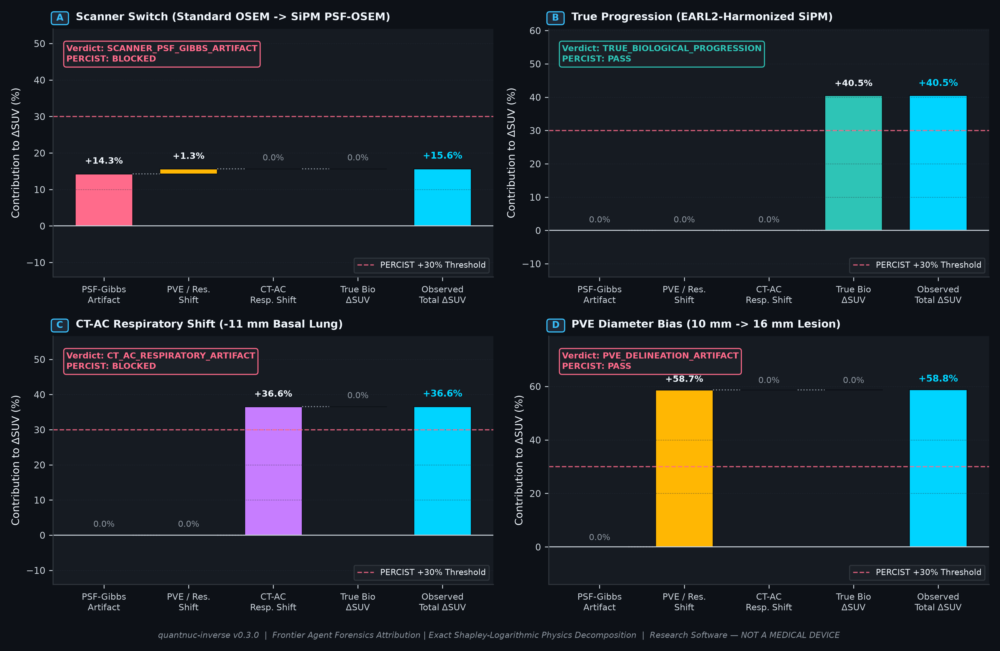

### 6. Saltelli–Jansen QMC Global Sobol' Sensitivity (Small vs. Large Lesion Regime Crossover)
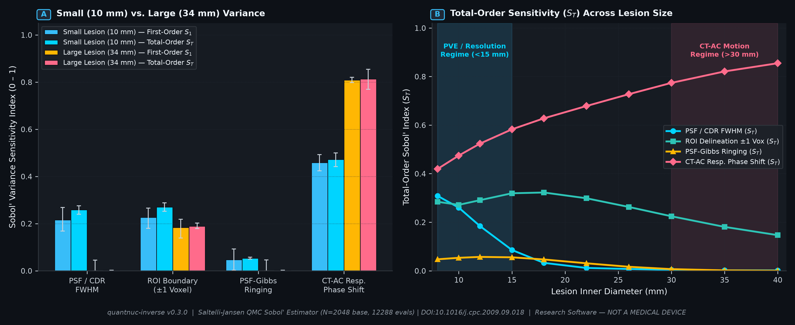

### 7. MIRD-26 $^{177}\text{Lu}$ PVE-Propagated Theranostic Absorbed Dose & PET Positron-Range Loss (`v0.2.0`)
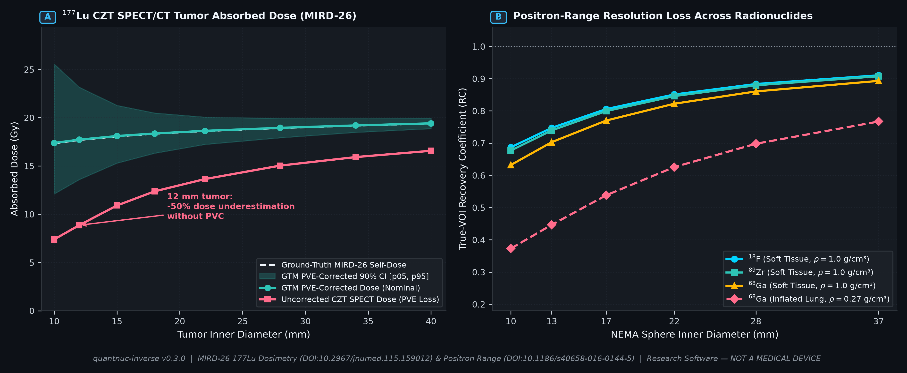

### 8. Noise-Constrained EARL2 Pareto Frontier ($\text{COV} \le 15\%$) & Necrotic-Core RBV PVC (`v0.2.0`)
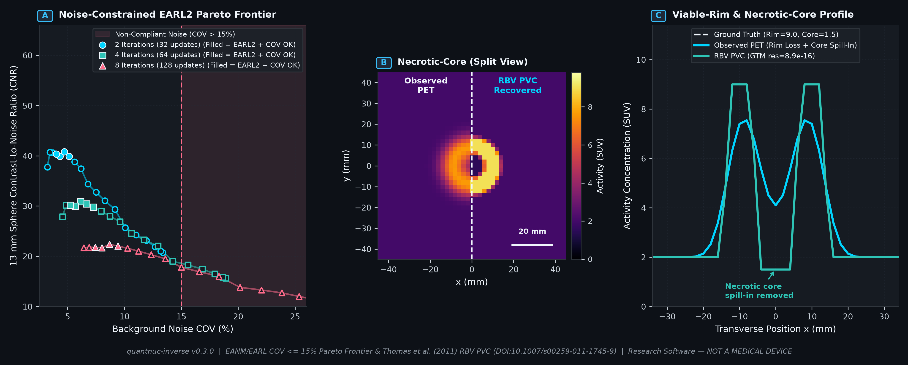

### 9. $N=1$ Retrospective Cross-Scanner Translation ($\mathcal{T}_{A\to B}$) vs. Size-Blind ComBat (`v0.3.0`)
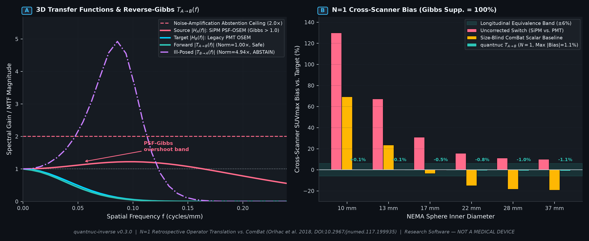

### 10. EANM Gear-2018 Full-Covariance Budget & Fisher-Optimal $^{177}\text{Lu}$ STP Protocol Designer (`v0.3.0`)
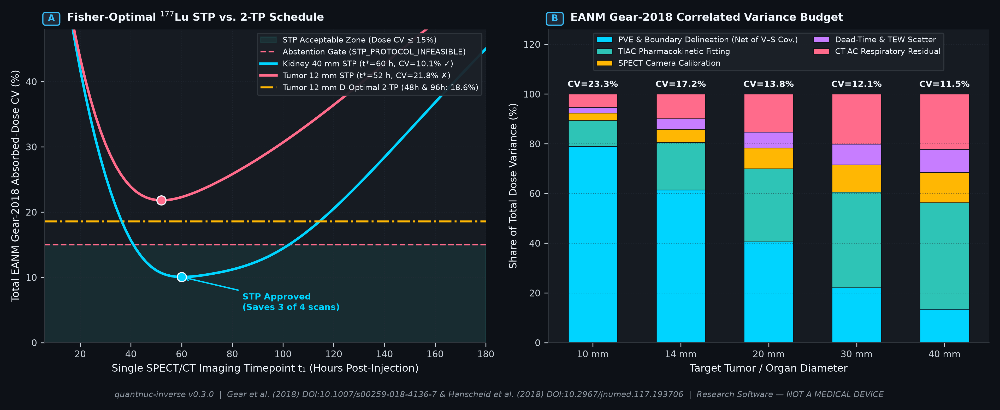

---

## Quick Start

```bash
# Install with uv (Python 3.12 recommended)
uv sync --python 3.12 --extra dev

# Stage NEMA NU 2-2018 DRO DICOMs + SHA-256 manifest
uv run python scripts/fetch_public_nucmed_sample.py

# Regenerate all 6 publication-grade figures (PNG + PDF)
uv run python scripts/generate_figures.py

# Run test suite, coverage, and linter
uv run pytest --cov=quantnuc_inverse --cov-report=term-missing
uv run ruff check src tests scripts
```

---

## API, Agent Harness & MCP Workflows

<details>
<summary><strong>1. Python API: EARL2 Harmonization & Rousset GTM Activity Recovery</strong></summary>

```python
from quantnuc_inverse import (
    LesionROI,
    build_reference_scanner_fleet,
    get_corridor_spec,
    invert_lesion_activity,
    synthesize_harmonization_filter,
)

# 1. Synthesize minimal Gaussian EARL2 filter for a Digital SiPM TOF-PSF PET scanner
sipm_scanner, sipm_recon = build_reference_scanner_fleet()[0]
harm = synthesize_harmonization_filter(sipm_scanner, sipm_recon, get_corridor_spec("EARL2"))
print(f"Optimal FWHM: {harm.optimal_post_filter_fwhm_mm:.2f} mm | Post violation: {harm.max_corridor_violation_after:.4f}")

# 2. Invert true lesion SUV from observed partial-volume-corrupted ROI mean
harm_recon = sipm_recon.model_copy(update={"post_filter_fwhm_mm": harm.optimal_post_filter_fwhm_mm})
roi = LesionROI(lesion_id="L_12mm", diameter_mm=12.0, observed_suv_mean=5.1, background_suv=2.0)
result = invert_lesion_activity(roi, sipm_scanner, harm_recon, method="GTM_EXACT")
print(
    f"Recovered SUV: {result.recovered_activity_nominal:.2f} "
    f"[p05={result.recovered_activity_p05:.2f}, p95={result.recovered_activity_p95:.2f}] "
    f"| Re-proj residual={result.forward_reprojection_residual:.2e}"
)
```
</details>

<details>
<summary><strong>2. Autonomous Quantitative Forensics Physicist & Critic-Verifier Dossier</strong></summary>

```python
from quantnuc_inverse.harness.agent_orchestrator import QuantitativeImagingForensicsAgent

agent = QuantitativeImagingForensicsAgent()
dossier = agent.build_complete_dossier()
md_path, json_path = dossier.write_bundle("outputs/dossier")
print(f"Audit Passed: {dossier.audit_report.overall_passed} | Gate: {dossier.audit_report.quantifiability_gate}")
print(f"Dossier: {md_path} | SHA-256 Ledger: {json_path}")
```
</details>

<details>
<summary><strong>3. MCP JSON-RPC 2.0 Server Configuration & Tool List</strong></summary>

Start the stdio MCP server via:
```bash
uv run quantnuc-mcp
```

Or register in an MCP client configuration:
```json
{
  "mcpServers": {
    "quantnuc-inverse": {
      "command": "uv",
      "args": ["run", "--directory", "/path/to/quantnuc-inverse", "quantnuc-mcp"]
    }
  }
}
```

**Exposed Provenance-Gated Tools (11):**
- `quantnuc_forward_nema_rc` — 3D NEMA NU 2-2018 6-sphere RCmean / RCmax / RCpeak simulation.
- `quantnuc_invert_pve_activity` — Rousset GTM, Müller–Gärtner, or Bayesian PVC inversion with 90% CI.
- `quantnuc_synthesize_earl_filter` — Minimal Gaussian/Butterworth EARL1/EARL2/QIBA/MIRD-23 filter synthesizer.
- `quantnuc_audit_ct_ac_mismatch` — Exact $\exp(\int \Delta\mu\,ds)$ CT-AC respiratory bias & abstention audit.
- `quantnuc_diagnose_suv_shift` — Longitudinal $\Delta\text{SUV}$ hypothesis falsification & attribution.
- `quantnuc_run_sobol_sensitivity` — Saltelli–Jansen QMC global Sobol' sensitivity ($S_1, S_T$, bootstrap CIs).
- `quantnuc_compute_theranostic_dose` — MIRD-23/26 PVE-propagated multi-timepoint tumor absorbed dose (Gy).
- `quantnuc_audit_3d_ct_ac_volume` — 3D bilinear HU-to-$\mu(E)$ volumetric CT-AC respiratory bias audit.
- `quantnuc_generate_physics_dossier` — Autonomous Forensics Physicist + Critic-Verifier Audit dossier.
- `quantnuc_translate_scanner_n1` — $N=1$ retrospective cross-scanner translation $\mathcal{T}_{A \to B} = \mathcal{H}_B \mathcal{H}_A^{-1}$ with Reverse-Gibbs & noise-amplification abstention.
- `quantnuc_design_stp_protocol` — EANM Gear-2018 full-covariance & Fisher-optimal Single-Timepoint (STP) vs. 2-Timepoint SPECT/CT schedule designer.

**CLI Subcommands (`uv run quantnuc ...`):**
```bash
uv run quantnuc harmonize --pet-standard EARL2 --noise-constrained
uv run quantnuc pvc --diameter 12 --observed-suv 5.1 --background-suv 2.0
uv run quantnuc audit-ac --shift-mm 10.0 --energy-kev 511.0
uv run quantnuc dose --diameter 14 --isotope Lu-177
uv run quantnuc translate --direction sipm-to-pmt
uv run quantnuc stp-design --diameter 40 --teff-mean-h 52 --teff-sd-h 12
uv run quantnuc dossier --output-dir outputs/dossier
```
</details>

---

## Documentation & Provenance

- [Engine Mathematical Specification](docs/ENGINE_SPECIFICATION.md)
- [Independent Verification & Audit Report](docs/AUDIT_REPORT.md)
- [Data Sources, Open Licenses & Verified BibTeX Citations](DATA_SOURCES_AND_CITATIONS.md)
- [Citation Metadata (CFF)](CITATION.cff)
- [NC-RPU-1.0 Non-Commercial Research & Personal Use License + Medical Device Disclaimer](LICENSE)
